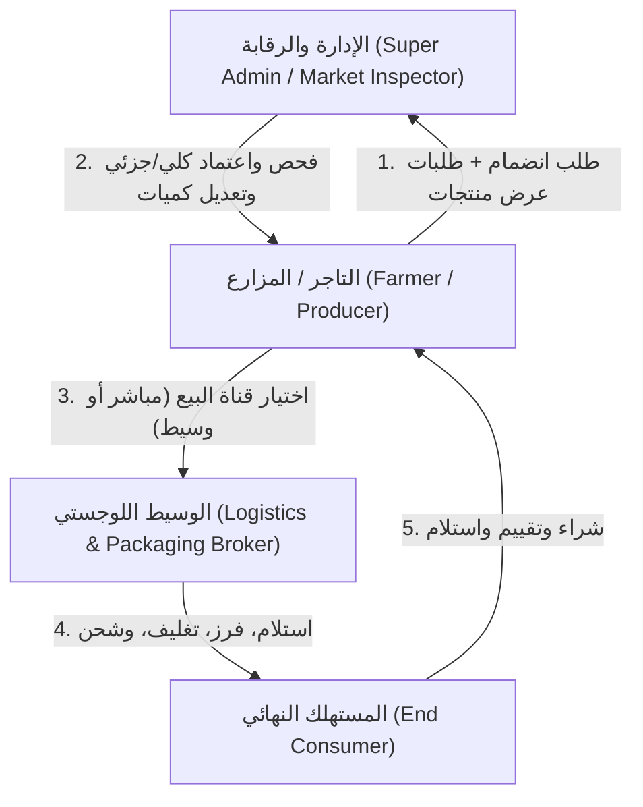
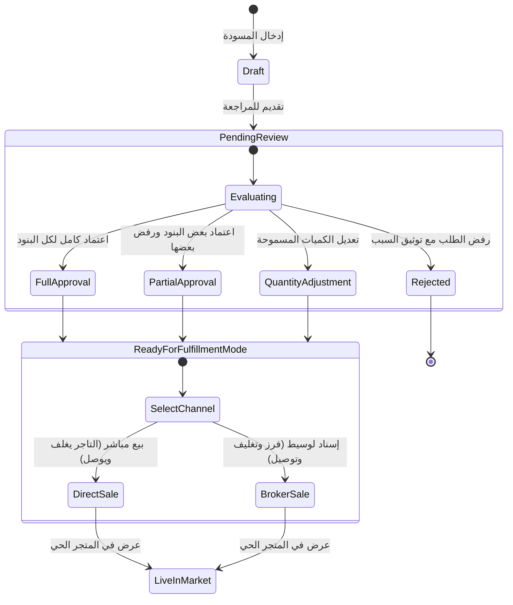
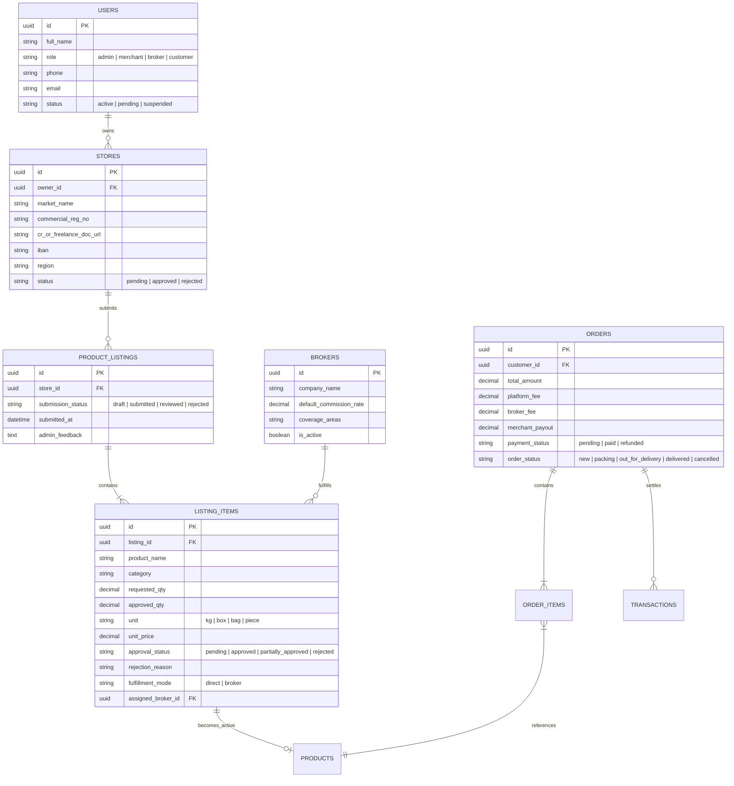

# منصة أسواق النفع العام الرقمية (Public Benefit Markets Platform)
## وثيقة التصميم المعماري والمواصفات الفنية (Architecture & Technical Specification)

---

### 1. نظرة عامة ورؤية النظام
منصة رقمية وطنية تربط أطراف سلاسل الإمداد الزراعي والغذائي في أسواق النفع العام:
- **المزارع / التاجر / مستأجر المزرعة**
- **شركات الخدمات اللوجستية والتغليف (الوسطاء)**
- **إدارة السوق والرقابة (Admin / Supervisor)**
- **المستهلك النهائي ومشتري الجملة والمباسط (Consumer / Commercial Stalls)**

---

### 2. الأدوار والمستخدمين (Roles & Permissions)



| الدور | الصلاحيات الرئيسية |
| :--- | :--- |
| **التاجر / المزارع** | التسجيل ورفع الوثائق الرسمية، إدراج دفعات المنتجات (Listing Requests)، اختيار قناة التنفيذ (مباشر أو عبر وسيط محدد)، إدارة المخزون، متابعة المحفظة المالية والمبيعات. |
| **إدارة السوق (Admin)** | تدقيق المنشآت والوثائق، مراجعة طلبات المنتجات (اعتماد كامل، اعتماد جزئي، تعديل الكمية المعتمدة، رفض مسبب)، إدارة نسب العمولات، تعيين وتدقيق الوسطاء اللوجستيين، مراقبة الأسعار وحركة السوق. |
| **الوسيط اللوجستي** | استلام مهام التجهيز من التجار المتعاقدين، تحديث حالة الفرز والتغليف، إصدار بوالص الشحن، متابعة تسليم الشحنات للمستهلك، وتتبع استحقاقات العمولة اللوجستية. |
| **المستهلك (Buyer)** | تصفح المنتجات المعتمدة حسب المنطقة/السوق، سلة التسوق، خيارات الدفع الإلكتروني، تتبع الطلبات لحظياً، تقييم الجودة والخدمة. |

---

### 3. مسار دورة حياة المنتج واعتماد الإدارة (Product Approval Workflow)



---

### 4. النموذج المالي ونظام العمولات (Financial & Commission Model)

تقوم المنصة بإجراء المقاصة الآلية فور تأكيد اكتمال الطلب والتسليم عبر المحفظة الرقمية (Escrow / Wallet Ledger):

```
[إجمالي الدفع من العميل: 100 ر.س]
          │
          ├──> في حالة البيع المباشر (Direct):
          │      ├── عمولة المنصة (مثلاً 5%): 5 ر.س
          │      └── صافي رصيد التاجر: 95 ر.س
          │
          └──> في حالة البيع عبر وسيط (Broker-assisted):
                 ├── عمولة المنصة (مثلاً 5%): 5 ر.س
                 ├── أتعاب التغليف والتوصيل للوسيط (مثلاً 10%): 10 ر.س
                 └── صافي رصيد التاجر: 85 ر.س
```

---

### 5. مخطط قاعدة البيانات المقترح (Database Schema Design)



---

### 6. المكدس التقني المقترح للتنفيذ (Recommended Tech Stack)

1. **واجهة المستخدم واللوحات (Frontend & Portals):**
   - **Next.js 14+ / React (Vite / Tailwind CSS / Lucide Icons)**
   - دعم كامل للغة العربية والاتجاه من اليمين لليسار (RTL) مع تصميم عصري وسريع.
   - 4 بوابات تفاعلية متصلة:
     - 🛍️ **متجر المستهلك (Consumer Storefront)**
     - 👨‍🌾 **لوحة التاجر والمزارع (Merchant Portal)**
     - 🛡️ **لوحة إدارة السوق والاعتمادات (Admin Governance Portal)**
     - 🚚 **لوحة الوسيط وشركات التوصيل (Broker Logistics Portal)**

2. **الواجهة الخلفية وقاعدة البيانات (Backend & API):**
   - بنية خدماتية معتمدة على REST/API أو Next.js Fullstack مع SQLite/PostgreSQL لدعم سرعة التطوير وحفظ البيانات الحية.

---

### 7. خطة العمل والتنفيذ (Roadmap to MVP)

- [x] **تحديد المواصفات المعمارية ودورة حياة الطلبات والعمولات.**
- [ ] **بناء وتجهيز النظام التفاعلي الشامل (Interactive Working Prototype / MVP).**
- [ ] **اختبار سيناريوهات الاعتماد الجزئي، تعديل الكميات، واختيار قنوات البيع (مباشر vs وسيط).**
